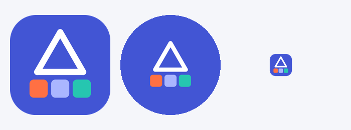

# Turingclides



**Turingclides é um aplicativo Android para praticar matemática e aprender a interpretar código Dart.** O estudante pode resolver contas contra o relógio, pedir uma dica em um problema de matemática ou acompanhar, passo a passo, como um programa chega à sua saída.

O aplicativo funciona offline. O perfil, as partidas e o progresso ficam salvos no próprio aparelho. O nome combina **Alan Turing** e **Euclides**, representados no ícone pela fita da máquina de Turing e pelo triângulo.

Projeto desenvolvido em **Flutter e Dart** para a disciplina de **Desenvolvimento Mobile da UNIPÊ**, com conceitos de orientação a objetos estudados em **Análise e Projeto de Sistemas II**.

**[Baixar o APK v1.0.0 para Android](https://github.com/Breno-Alexandre1604/turingclides/releases/download/v1.0.0/Turingclides-v1.0.0.apk)** · [Instruções de instalação e verificação do arquivo](https://github.com/Breno-Alexandre1604/turingclides/releases/tag/v1.0.0)

Requer Android 7.0 ou superior.

## Modos de jogo

| Modo | Como funciona |
| --- | --- |
| **Conta Rápida** | Escolha as operações e um dos três níveis de dificuldade. Você tem 10 segundos para resolver cada conta. A pontuação considera o acerto, o tempo de resposta e a sequência de acertos. |
| **Quiz de Matemática** | São 10 questões de quatro alternativas sobre assuntos como porcentagem, frações, geometria e probabilidade. Você pode pedir uma dica antes de responder e conferir a resolução depois. |
| **Quiz de Lógica** | Leia um dos 10 trechos de código Dart e tente prever a saída. Após responder, explore a execução para descobrir como os valores das variáveis mudam. |

## Experimente o teste de mesa

1. Na Home, abra **Quiz de Lógica**, selecione **Fácil** e inicie uma rodada com **1 pergunta**.
2. Na questão que termina com `print(total)`, escolha uma alternativa e confirme a resposta.
3. Toque em **Ver execução**. A cada iteração, o programa soma `valor × i` ao acumulador e depois diminui `valor`. As parcelas são **3, 4 e 3**, e o total passa por **3, 7 e 10**.
4. Use **Anterior** e **Próximo** para rever o cálculo. Ao concluir a rodada, abra o **Histórico** para consultar sua resposta.

## Perfil e progresso

- **Perfil** — escolha um apelido, consulte seus pontos e recordes e alterne entre os temas claro, escuro ou do sistema.
- **Histórico** — abra uma partida concluída para rever as respostas daquela rodada.
- **Progresso** — acompanhe sua taxa de acerto por assunto para decidir o que estudar em seguida.

No Android, os dados são armazenados em **SQLite**. A versão de demonstração no Chrome usa o armazenamento local do navegador quando ele está disponível.

## Executar o projeto

Para desenvolver, use o **Flutter 3.50** e o **Dart 3.14** como referência. Para executar no Android, configure o Android SDK e conecte um celular com depuração USB ou inicie um emulador.

```powershell
git clone --branch main https://github.com/Breno-Alexandre1604/turingclides.git
cd turingclides
flutter doctor
flutter pub get
flutter devices
flutter run
```

Quando o Flutter listar os dispositivos, selecione o Android desejado. Para abrir a demonstração diretamente no Chrome, execute:

```powershell
flutter run -d chrome
```

### Análise e testes

Na pasta que contém o `pubspec.yaml`, execute:

```powershell
flutter analyze
flutter test
```

A suíte inclui testes de regras dos jogos, interface e persistência. Entre os comportamentos verificados estão o bloqueio de uma resposta já confirmada e a gravação da mesma partida sem duplicar os pontos. [Consultar os testes](test/)

### Gerar o APK no Windows

```powershell
.\tool\gerar_apk_release.ps1
```

O script instala as dependências, executa a análise e os testes e gera `build\app\outputs\flutter-apk\app-release.apk`. [Guia de assinatura e instalação](docs/SEGURANCA.md)

## Como o código foi organizado

Os dois quizzes compartilham a tela de perguntas e o controlador da partida. O padrão **Strategy** permite variar o banco de questões e o tipo de feedback. Assim, confirmar uma resposta em Matemática apresenta a resolução do cálculo. Em Lógica, a mesma ação também dá acesso ao teste de mesa. [Estratégias dos quizzes](lib/domain/games/quiz_compartilhado/quiz_strategy.dart) · [Controlador da partida](lib/application/partida_controller.dart)

| Pasta | Conteúdo |
| --- | --- |
| [`lib/presentation/`](lib/presentation/) | Home, configuração das atividades, telas dos jogos, perfil, histórico e progresso |
| [`lib/application/`](lib/application/) | Controle das partidas e serviços de perfil e progresso |
| [`lib/domain/games/`](lib/domain/games/) | Gerador de contas, bancos de questões, pontuação e feedback |
| [`lib/domain/models/`](lib/domain/models/) | Modelos de jogador, partida, resposta e progresso |
| [`lib/domain/contracts/`](lib/domain/contracts/) | Contratos de acesso aos dados |
| [`lib/data/`](lib/data/) | Implementações de persistência para Android e navegador |

## Equipe

| Integrantes | Contribuição |
| --- | --- |
| **Leonardo e Lucas** | Estrutura do aplicativo, tema, Home, navegação e integração dos módulos |
| **Eduardo** | Conta Rápida, geração das operações, cronômetro e pontuação |
| **Breno** | Quizzes de Matemática e Lógica, dicas, explicações e teste de mesa interativo |
| **Renan** | SQLite, perfil local, histórico, recordes, progresso, segurança do APK e integração contínua |

## Documentação

- [Visão geral do aplicativo](docs/VISAO_GERAL.md)
- [Roteiro da apresentação da equipe](docs/APRESENTACAO.md)
- [Demonstração dos quizzes](docs/DEMONSTRACAO_QUIZZES.md)
- [Dados e progresso](docs/DADOS_E_PROGRESSO.md)
- [Identidade visual](docs/IDENTIDADE_VISUAL.md)
- [Estrutura de pastas](docs/ESTRUTURA_TURINGCLIDES.md)
