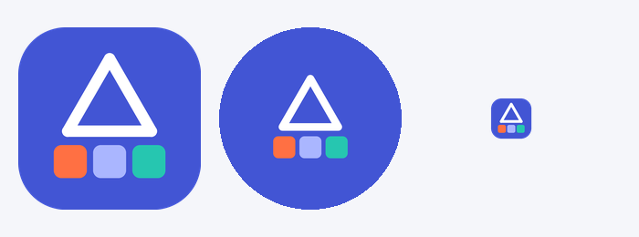

# Identidade visual e regras da interface

O visual continua o do protótipo de Leonardo: índigo da marca, cartões brancos sobre fundo claro e uma cor para cada jogo. Este refinamento organizou esse visual em regras, para que toda tela siga o mesmo padrão no modo claro e no escuro.



## Ícone

O nome junta **Turing** e **Euclides**, e o ícone também:

- o **triângulo** é a geometria de Euclides;
- a **fita de três células** é a máquina de Turing, com uma célula para cada jogo: laranja (Conta Rápida), índigo claro (Matemática) e verde-azulado (Lógica);
- o triângulo fica sobre a célula do meio, como a cabeça de leitura da máquina.

| Arquivo | Para quê |
| --- | --- |
| `android/app/src/main/res/mipmap-anydpi-v26/ic_launcher.xml` | Ícone adaptativo do Android 8+: o celular recorta em círculo, gota ou quadrado |
| `android/app/src/main/res/drawable/ic_launcher_foreground.xml` | Desenho em vetor, nítido em qualquer tela |
| `android/app/src/main/res/drawable/ic_launcher_monochrome.xml` | Versão de uma cor para os ícones temáticos do Android 13+ |
| `android/app/src/main/res/mipmap-*/ic_launcher.png` | Androids antigos |
| `web/icons/`, `web/favicon.png` | Versão de navegador |
| `lib/presentation/widgets/marca.dart` | A mesma marca desenhada dentro do app (barra da Home) |

Para mudar o ícone, edite as medidas em `tool/gerar_icone.py` e rode `python tool/gerar_icone.py .` na raiz do projeto (precisa do Python com o pacote Pillow). O script gera todos os arquivos acima e a prévia `docs/img/icone.png`.

## Regras de equilíbrio

Todas ficam em `lib/app/app_theme.dart`. As telas usam esses nomes, nunca números ou cores soltas.

| Regra | Valor | Onde aparece |
| --- | --- | --- |
| Escala de espaços (`Espaco`) | 4, 8, 12, 16, 20, 24, 32, 40 | Itens do mesmo grupo usam passos curtos (4 a 12); grupos diferentes, passos longos (24 a 40) |
| Margem lateral | 20 no celular | `PaginaRolavel`, em todas as telas |
| Largura máxima (`Largura`) | 640 para leitura, 560 para jogo e resultado | Em tablet, paisagem ou navegador o conteúdo fica centralizado e não estica |
| Títulos de seção | 24 acima, 8 abaixo | `TituloDeSecao`: o título fica perto do conteúdo que apresenta |
| Cantos (`Raio`) | 14 em controles, 20 em cartões, 16 nos ícones dos modos | Botões, campos, cartões |
| Toque | Botão principal com 52 de altura; secundários e alternativas com pelo menos 48 | Regra do Material 3 para dedo |
| Números | Algarismos de largura fixa (`numerosTabulares`) | Pontos, cronômetro e porcentagens não "dançam" quando mudam |
| Tipografia | Escala do Material 3 (Roboto), títulos em peso 700 a 800 | Nenhum tamanho de fonte escolhido à mão |

## Modo claro e escuro

- O jogador escolhe em **Perfil → Aparência**: Sistema (padrão), Claro ou Escuro. A escolha vale na hora e fica salva no aparelho (tabela `preferencia`, veja [Dados e progresso](DADOS_E_PROGRESSO.md)).
- As cores saem de papéis do Material 3 gerados a partir do índigo da marca. No claro, fundo cinza-azulado e cartões brancos; no escuro, fundo escuro e cartões um tom acima.
- Cada jogo tem uma cor (`CoresDoApp`): laranja, índigo e verde-azulado, com variantes próprias para o escuro que mantêm o contraste. Há também a cor de acerto (verde) e a de recorde (âmbar). Erro usa a cor de erro do Material.
- O cronômetro da Conta Rápida fica vermelho nos 3 segundos finais.

## Dados do jogador na interface

- **Home**: cartão do jogador no topo com apelido, pontos, partidas e acerto geral. Cada jogo mostra o recorde do jogador. A Home se atualiza sozinha ao voltar de uma partida.
- **Seus dados**: Perfil, Histórico e Progresso em abas.
- **Perfil**: apelido editável, pontos, respostas corretas com barra de acerto, recordes por modo com a cor de cada jogo, aparência e privacidade.
- **Progresso**: barra de acerto por assunto na cor do modo.

## Rolagem e toque

- **Sem rolagem desnecessária**: uma tela só rola quando o conteúdo não cabe nela (celular pequeno, teclado aberto, histórico longo). Home, configurações, partida da Conta Rápida e Perfil cabem num celular comum e ficam paradas. O Flutter deixa a lista principal de cada tela "sempre rolável" por padrão; `PaginaRolavel` desliga isso.
- Quando rola, a lista usa a física nativa do Android e estica na borda (Android 12+).
- Arrastar para os lados troca as abas de Perfil, Histórico e Progresso, e cada aba guarda a posição da rolagem. Cada partida do histórico guarda se está aberta ou fechada.
- Arrastar a lista fecha o teclado, menos na Conta Rápida, onde um toque torto não pode esconder o campo no meio do cronômetro.
- No simulador web, o mouse também arrasta as listas e as abas.
- O gesto de voltar do Android mostra a prévia da tela anterior (voltar preditivo, Android 14+).
- Datas, horas e textos dos componentes do Material aparecem em português do Brasil.

## Como conferir

```powershell
flutter test test/widgets/aparencia_test.dart test/widgets/rolagem_test.dart
```

- `aparencia_test.dart` troca o tema no perfil, fecha e abre o app, confere a Home atualizando com uma partida nova e troca de aba deslizando.
- `rolagem_test.dart` abre as telas num celular comum (393 × 851 dp) com a fonte Roboto de verdade e confere que as que cabem não rolam nem aceitam arrasto, e que um histórico longo continua rolando.

A conferência visual foi feita no navegador em tamanho de celular, no claro e no escuro. Ainda falta ver no celular de verdade.
